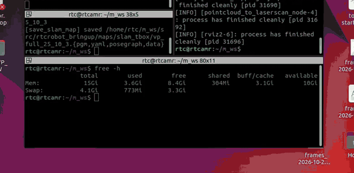
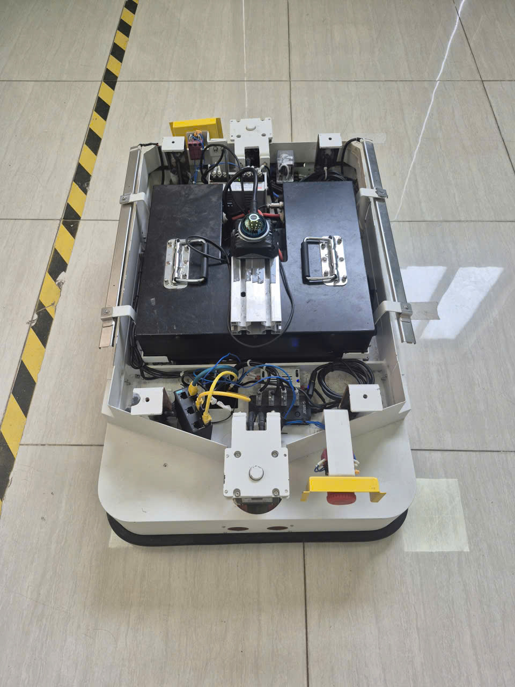
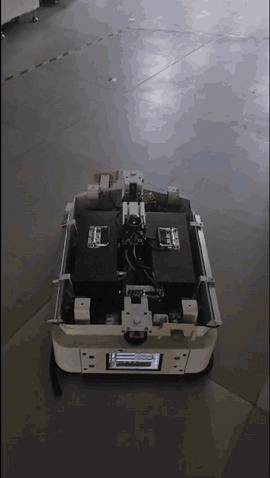
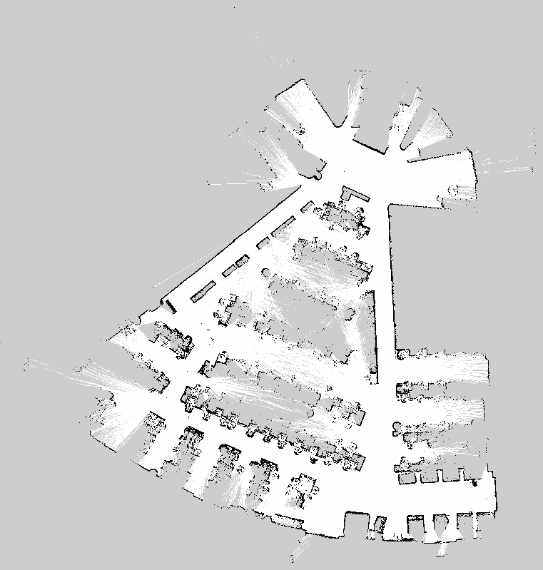

# fastlio_slam_toolbox_amr


**English** | [Tiếng Việt](README.vi.md)

2D mapping and localization for an AMR with a **Livox MID-360**.
[FAST-LIO2](https://github.com/hku-mars/FAST_LIO) provides the odometry and
[slam_toolbox](https://github.com/SteveMacenski/slam_toolbox) builds a 2D map and localizes on it.
No wheel odometry is needed. Tested on a real AMR.

<p align="center">
  
</p>

<p align="center">
  
  
  
  <br>
  <sub>Test robot · mapping run · saved map (5 cm per cell)</sub>
</p>

## How it works

1. **FAST-LIO2** publishes the odometry (`odom → base_link`) and a motion-compensated point cloud.
2. The cloud is sliced between 0.05 m and 1.0 m above `base_link` and flattened into a
   360° scan, `/livox/scan`.
3. **slam_toolbox** builds the map from `/livox/scan`, publishes `/map` and `map → odom`.
   nav2 can use `/map` directly.

## Requirements

- Ubuntu 22.04 and ROS 2 Humble
- Livox MID-360
- `base_link` must be the root of your URDF: FAST-LIO2 publishes its parent

## Installation

### 1. Tools

```bash
sudo apt install python3-vcstool python3-rosdep python3-colcon-common-extensions
sudo rosdep init   # first time only
rosdep update
```

### 2. Livox-SDK2

```bash
git clone https://github.com/Livox-SDK/Livox-SDK2.git
cd Livox-SDK2 && mkdir build && cd build
cmake .. && make -j"$(nproc)"
sudo make install
```

### 3. Workspace

This package, FAST-LIO2 and the Livox driver:

```bash
mkdir -p ~/ros2_ws/src && cd ~/ros2_ws/src
git clone https://github.com/ManhVT1601/fastlio_slam_toolbox_amr.git
vcs import --recursive . < fastlio_slam_toolbox_amr/dependencies.repos

# livox_ros_driver2 ships ROS 1 and ROS 2 files: select ROS 2
cd livox_ros_driver2
cp package_ROS2.xml package.xml
cp -r launch_ROS2 launch
```

### 4. Build

```bash
cd ~/ros2_ws
rosdep install --from-paths src --ignore-src -r -y
colcon build --symlink-install \
  --cmake-args -DCMAKE_BUILD_TYPE=Release -DROS_EDITION=ROS2 -DHUMBLE_ROS=humble
source install/setup.bash
```

### 5. Lidar network

Give the PC's Ethernet port a static IP on the lidar's subnet (for example `192.168.1.50`).
Then set the PC IP (`host_net_info`) and the lidar IP (`lidar_configs` → `ip`) in
`src/livox_ros_driver2/config/MID360_config.json`. The lidar IP is `192.168.1.1XX`, where `XX`
is the last two digits of its serial number.

## Usage

**1. Start the lidar driver** and your robot's own bringup (robot_state_publisher, motors):

```bash
ros2 launch livox_ros_driver2 msg_MID360_launch.py
```

**2. Build a map**

```bash
ros2 launch fastlio_slam_toolbox_amr mapping.launch.py rviz:=true \
  lidar_pose:="0 0 0.357 0 0 0"   # lidar in base_link: x y z roll pitch yaw (m, rad)
```

Keep the robot still for a few seconds at start-up, then drive slowly.
Drive back through places you have already mapped, so slam_toolbox can close loops.

**3. Save the map** while mapping is still running:

```bash
ros2 run fastlio_slam_toolbox_amr save_map ~/maps/office
# writes office.pgm/.yaml (occupancy grid) and office.posegraph/.data (for localization)
```

**4. Localize** on the saved map:

```bash
ros2 launch fastlio_slam_toolbox_amr localization.launch.py \
  map_file:=~/maps/office rviz:=true
```

By default the robot is assumed to start where mapping started. If it starts anywhere else,
click **2D Pose Estimate** in RViz, or pass `start_pose:="x y yaw"`.

**5. Navigate** with nav2, **without** `map_server` and AMCL: slam_toolbox already publishes
`/map` and `map → odom`.

## Main parameters

| Argument | Default | Meaning |
|---|---|---|
| `lidar_pose` | `0 0 0.357 -0.0048 0.0132 0` | Lidar mount in `base_link`: `x y z roll pitch yaw` |
| `min_height` / `max_height` | `0.05` / `1.0` | Height band (m above `base_link`) used for the 2D scan |
| `map_file` | (required) | Map saved by `save_map`, for localization |
| `start_pose` | `0 0 0` | Initial pose `x y yaw` in the map, for localization |
| `rviz` | `false` | Open RViz |

All arguments: `ros2 launch fastlio_slam_toolbox_amr mapping.launch.py --show-args`.
The FAST-LIO2 and slam_toolbox parameters are in [`config/`](config).

## Credits

This package only connects existing work:

- [FAST-LIO2](https://github.com/hku-mars/FAST_LIO), ROS 2 port
  [Ericsii/FAST_LIO_ROS2](https://github.com/Ericsii/FAST_LIO_ROS2) (GPL-2.0)
- [slam_toolbox](https://github.com/SteveMacenski/slam_toolbox) (LGPL-2.1)
- [pointcloud_to_laserscan](https://github.com/ros-perception/pointcloud_to_laserscan) (BSD)
- [livox_ros_driver2](https://github.com/Livox-SDK/livox_ros_driver2) (MIT)

These are installed separately and keep their own licenses. This repository (launch files,
configuration and scripts) is under the [Apache-2.0](LICENSE) license.
